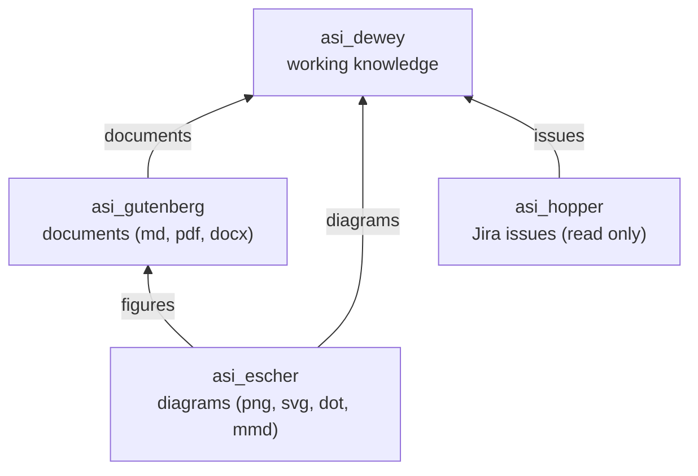
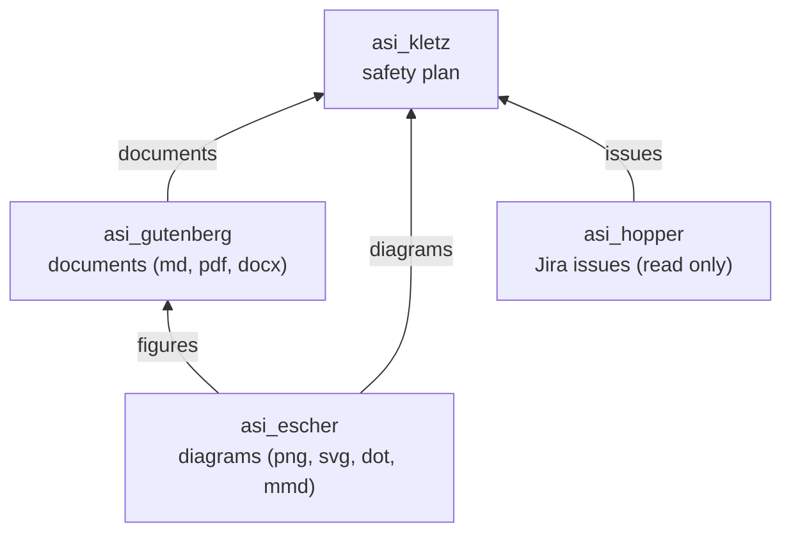

# ASI FuSa Tools

Eight sibling repositories in one folder, one naming scheme, one job: the functional-safety tooling
for the Wheel Loader programme. Every tool repo is called `asi_<surname>` after a person whose
life's work is the job the repo does; this repo, `asi_fusa_tools`, is the charter they all follow.
The name tells you the role before you open the folder.

| Repo | Named after | Because | Role | Package / command | Version |
|---|---|---|---|---|---|
| `asi_dewey` | **Melvil Dewey** (1851 to 1931), librarian, inventor of the Dewey Decimal Classification | one classification scheme, many views | **Primary tool.** Functional-safety working-knowledge store for the Wheel Loader programme: tasks, facts, machine functions, use cases, links, Jira tickets (cached from Jira through asi_hopper), QMS documents, and people; the safety plan rows it still carries are a cached copy edited in asi_kletz, and since 0.4.0 it shows no Jira or Safety Plan windows of its own. The STPA control structures and the STPA step objects it built in 0.9.0 to 0.10.1 moved to asi_kletz 0.24.0 by the owner's decision of 2026-10-29 ("control structures were supposed to go into Kletz and not Dewey ... move everything to Kletz") and left Dewey in 0.11.0, which keeps `handover`: the thirteen tables of an older database written out in the shapes Kletz reads. The family rule, the same day: "Dewey is more for experimental and day to day; all true work products will end up in Kletz once sanitized." SQLite is the truth; Excel and JSON are generated views; a CLI and a tkinter window drive the same command path. | `asi_dewey` / `asi-dewey`, `asi-dewey-gui` | 0.11.2 |
| `asi_kletz` | **Trevor Kletz** (1922 to 2013), chemical engineer, father of inherently safer design and HAZOP | taught industry to ask of every line of a plan what could go wrong | **Primary tool.** The platform **Safety Plan**: one row per deliverable with its lifecycle phase, location, QMS references, author, verifier, reviewers, deadline, and status, the sprints and the weekly tracker, the parametrised standards filled from the plan, Jira and Confluence read only through asi_hopper; and since 0.24.0 the home of STPA next to the plan: the control structures (the controllers, their algorithms and process models, the control actions and feedback; built by a factory, drawn by asi_escher as draw.io, PNG and SVG with the OCR gate on, a CRUD screen with its Export… dialog) and the STPA step objects (losses, hazards, UCAs, scenarios, constraints) read from a Confluence page with a citation each and linked to a structure; the real wheel loader structure stays in asi_standards and in the owner's database. Same architecture as Dewey, split from it on 2026-10-27, shares nothing with it at runtime. | `asi_kletz` / `asi-kletz`, `asi-kletz-gui` | 0.24.2 |
| `asi_escher` | **M. C. Escher** (1898 to 1972), graphic artist of impossible geometry | he drew structure | **Generator.** Pure-Python diagram engine: activity, flowchart, state machine, SysML BDD / IBD / REQ diagrams and, since 0.2.0, STPA control structures, laid out by a deterministic layered algorithm and written as an editable draw.io file (the positions of the layout) and rendered to PNG, SVG, Graphviz DOT, and Mermaid; an OCR gate reads the PNG back and says whether every label is legible. No Graphviz, Node, draw.io or browser needed. | `asi_escher` / `asi-escher` | 0.2.2 |
| `asi_gutenberg` | **Johannes Gutenberg** (c. 1400 to 1468), inventor of the movable-type printing press | he made documents reproducible | **Generator.** Pure-Python document engine: specs, reports, plans, procedures, minutes, memos, safety cases, ICDs, analyses, checklists, and release notes, written as Markdown (the source of truth) and rendered from that Markdown to PDF and Word as a triplet that can never disagree. | `asi_gutenberg` (library only) | 0.9.1 |
| `asi_hopper` | **Grace Hopper** (1906 to 1992), rear admiral, compiler pioneer | she built the first compiler so people could instruct a machine in their own words | **Gateway.** Read-only, audited, replayable door into Jira and, since 0.1.7, Confluence for the Wheel Loader programme: a library, a CLI, and a fixture-replay gateway so siblings and tests never touch the network. OAuth 2.1 through Atlassian's Remote MCP Server, no API tokens, no writes. Feeds live issues to both primary tools. | `asi_hopper` / `asi-hopper` | 0.1.10 |
| `asi_fusa_tools` | nobody; it is the charter, not a tool | | **Charter.** This document, the conventions every repo tests against, and the plans index. No code. | none | dated |
| `asi_standards` | nobody; it is a shelf, not a tool | | **Private.** The parametrised standards: a controlled document brought in from Word with asi_gutenberg (`from_docx`), the original preserved byte for byte with its SHA-256, the imported Markdown source beside it, its blanks named as `{{ parameters }}` and filled at build: the vehicle type, one value per role (since asi_kletz 0.19.0 the people in the role, name and email each, alphabetical, rendered inline), and per deliverable the points, sprint end, Jira key and status Kletz supplies, and since asi_kletz 0.20.0 the work product's link (`row_N_url`, the first URL) and all its URLs (`row_N_urls`). Documents and dated entries, no code. First: the QF-17 Safety Plan (2026-10-29). | `asi_standards` | dated |
| `asi_onboarding` | nobody; it is a corpus, not a tool | | **Content.** The October 2026 onboarding sessions as work products: the shareable transcript corpus (v.01 to v.05: people as positions in brackets, employee-only topics removed; the verbatim v.00 and the biographies were deleted for PII and are not to be recreated), 64 diagrams drawn with asi_escher, ten decks built from them. A content repo, no package. | none | dated |

## The ontology

Three tiers. **Primary tools** are what a human or an agent opens: each owns a database, a command
vocabulary, a CLI, and a desktop window. **Generators** are libraries: no database, no window, no
state; they take a plain-data model and produce files. **Gateways** are libraries with a session
and an evidence folder but no database of their own: they read an external system and hand plain
records up to the primary tools.

The rule that ties them together: **primary tools must be able to use every generator and every
gateway**, and the document generator must be able to use the diagram generator so that a document
can carry its own figures.

One diagram per primary tool. The generators and the gateway under each are the same; the tools
never appear in one diagram because they never depend on each other.

### asi_dewey



For readers without Mermaid:

```
                 +-----------+
                 | asi_dewey |                        primary tool: working knowledge
                 +-+---+---+-+
                   ^   ^   ^
      documents   /    |    \   issues
                 /     |     \
   +-------------+-+   |   +-+--------------+
   | asi_gutenberg |   |   | asi_hopper    |      generator: documents / gateway: Jira, read only
   +------+--------+   |   +----------------+
          ^  figures   |  diagrams
          |            |
       +--+------------+--+
       |    asi_escher    |                        generator: diagrams (needs nothing)
       +------------------+
```

### asi_kletz



For readers without Mermaid:

```
                 +-----------+
                 | asi_kletz |                        primary tool: safety plan
                 +-+---+---+-+
                   ^   ^   ^
      documents   /    |    \   issues
                 /     |     \
   +-------------+-+   |   +-+--------------+
   | asi_gutenberg |   |   | asi_hopper    |      generator: documents / gateway: Jira, read only
   +------+--------+   |   +----------------+
          ^  figures   |  diagrams
          |            |
       +--+------------+--+
       |    asi_escher    |                        generator: diagrams (needs nothing)
       +------------------+
```

Arrows point from the generator or gateway to what it serves: Escher feeds diagrams up to Gutenberg
and to the tool, Gutenberg feeds documents up to the tool, and Hopper feeds Jira issues up to the
tool. Nothing flows back down.

Edges, spelled out:

| Consumer | Uses | For |
|---|---|---|
| `asi_dewey` | `asi_escher` | diagrams of the lifecycle, the plan, tasks, and the schema itself |
| `asi_dewey` | `asi_gutenberg` | the safety plan document, status reports, the working-knowledge handbook |
| `asi_kletz` | `asi_escher` | diagrams of the lifecycle, each phase's flow, the status board; since 0.24.0 the STPA control structures (the `control_structure` kind, the draw.io file, the OCR gate) and the STPA trace |
| `asi_kletz` | `asi_gutenberg` | the Safety Plan document, status reports, phase checklists, the filled standards; since 0.24.0 the STPA report |
| `asi_dewey` | `asi_hopper` | live Jira issues: the JIRA Live Data window, `jira sync` into the ticket cache |
| `asi_kletz` | `asi_hopper` | live Jira issues: the JIRA Live Data window; `jira_key` on every plan row (0.14.0) and the ticket picker on every work product (0.15.0); Confluence read only (0.23.0: `confluence` search, page, link, evidence, check) and since 0.24.0 the STPA step objects read from a page bundle |
| `asi_gutenberg` | `asi_escher` | a `diagram` block that renders to a figure inside the document |
| `asi_escher` | nothing | the bottom of the stack |
| `asi_hopper` | nothing from the tools | a gateway: it reads Jira and knows nothing about the tools |

Non-edges matter as much:

- **Dewey and Kletz never import each other.** They share an architecture by copying, not a
  package. No shared database, workbook, or config file. That is a deliberate property, checked by
  Kletz's test suite. The one thing they share is a **convention**, not code: the family lock
  below, including its single environment variable.
- **Generators never import a primary tool.** Escher and Gutenberg know nothing about SQLite,
  commands, or windows. A primary tool builds the plain-data model and hands it over.
- **Gateways never import a primary tool, and never write.** Hopper reads Jira and hands plain
  records up; each tool decides what to keep in its own database, and Jira stays the truth for
  tickets the way the database stays the truth for everything else.
- **Generated files are views, never truth.** Exactly like the Excel workbook: a diagram or a
  document is regenerated from the database on demand and is never read back into it.

## House rules every repo follows

- Python 3.13, [uv](https://docs.astral.sh/uv/) with `uv_build`, `src/` layout, `ruff`, `pytest`.
- `tool.uv.link-mode = "copy"` in every `pyproject.toml`, because OneDrive refuses the hardlinks
  uv makes from its cache.
- Semantic versioning, a `CHANGELOG.md` in Keep a Changelog form, a `v<x.y.z>` tag per release.
- Factories and registries over edits to core code: a new entity, verb, exporter, screen, diagram,
  or document is added by registration.
- Everything a window can do, a command can do. The window is a client of the command path.
- No person is named inside Dewey or Kletz; the tools are for a role, not for someone.
- A documentation-only repo (`asi_fusa_tools`) carries a `README.md`, a `CHANGELOG.md` with dated
  entries, and git history, and nothing else: no `pyproject.toml`, no `uv`, no tests.
- Conventions keep their names once tests refer to them: *the family lock* and *the family
  palette* stay so named.
- A controlled document (a QMS form, a plan with people's names) never enters a public repo, not even in
  history: it lives in `asi_standards` (private), and asi_gutenberg's tests look for that checkout beside
  themselves and skip when it is absent (owner, 2026-10-29).
- Continuous integration (2026-10-28): every Python repo carries `.github/workflows/ci.yml`, which runs
  `ruff check src tests` and `pytest -q` on `windows-latest` (Tk is there, so the GUI tests run) on every
  push to main, every `v*` tag and every pull request; a repo that depends on siblings checks them out
  beside itself. A release is green by that run, not by anyone's word.

## Policies

Owner decisions that bind every repo and every agent brief, collected here so no plan has to rediscover them:

- **Jira: reads only; the write side is closed (owner, 2026-10-27).** asi_hopper is the one door and it
  never writes; no tool, plan or agent proposes Jira writes or a sandbox for them, and the question is not
  raised again.
- **Confluence: reads only.** The tools and the agents read Confluence pages as reference and never create or
  edit one.
- **Controlled documents stay private.** A QMS document, a form or a plan with people's names lives in
  `asi_standards` (private) and never enters a public repo, not even in history; asi_gutenberg (public) holds
  the machinery and none of the documents.
- **The sprint rule.** A sprint is 14 calendar days, Tuesday to the Monday 13 days later, and 8 points; the next
  starts the next day; a holiday never moves, stretches or shortens a sprint and never cuts the points; sprints
  are numbered across the programme from Sprint 31 (2026-10-27 to 2026-11-09), the picture from systems
  engineering being the law (the Sprints section below). The owner, 2026-10-29: "this supersedes anything I said
  before"; the rule of 2026-10-28 (10 business days, holidays stretching the dates) is gone. Every brief that
  touches sprints, estimates or deadlines carries it.
- **The privacy wording for onboarding material.** The verbatim transcript dump with names (v.00) and the
  biographies were *deleted for PII*; they were never moved, archived or kept elsewhere, and are not to be
  recreated. Text anywhere that says otherwise is wrong and is corrected.
- **Exports fill the Word original in place.** A controlled document leaves the tools as its own Word file
  filled, never as a rendering of it: asi_gutenberg 0.7.0's `fill_docx` writes the values into the original (the
  template exactly, the marks on what was filled, the links blue, every table's header row repeating per page)
  and the PDF is Word's own print; asi_kletz 0.16.0's `plan export` does this for the QF-17 Safety Plan. The
  Markdown rendering is for documents that have no original.
- **Dewey is experimental and day-to-day; true work products end up in Kletz once sanitized.** The owner,
  2026-10-29: "Dewey is more for experimental and day to day; all true work products will end up in Kletz once sanitized." What is explored in asi_dewey is handed to asi_kletz when it becomes a work product
  (`asi-dewey handover`, 0.11.0), and a new work product is built in Kletz, never in Dewey; the STPA control
  structures and step objects were the first case (asi_kletz 0.24.0, asi_dewey 0.11.0). STPA lives in Kletz: the
  control structures and the step objects sit next to the safety plan there, and Dewey holds none of it since
  0.11.0.

## Identity: `id` and `uid`

Decided 2026-10-28, implemented in asi_dewey 0.8.0 and asi_kletz 0.9.0 (the two
`docs/hidden-identity-plan.md`). Every row of every entity in both tools has two identities:

- **`id`**, the integer primary key: the handle. It is what a command takes (`update task 2 ...`),
  the row iid of every tree, the audit log's `entity_id`, the status bar's "Task 2 selected" and
  the details frame's title. It is typed by people and agents all day, so it stays short. It is
  stable inside one database only and is **shown in no table**.
- **`uid`**, a canonical lowercase UUID4 (36 characters): the trace. Assigned once on creation,
  never changed (`update` refuses it: `uid is immutable`), unique per table, hidden from every table
  and form (`FieldSpec.hidden`, `EntitySchema.visible_fields`), carried by every file the tool
  writes (the last key of a JSON row; the last column of every workbook sheet, headed `uid` and
  hidden in the sheet) and honoured by every import: a row whose uid is known is an update of that
  row whatever its id in the file; otherwise an id that is known is an update by id in merge mode,
  and the stored uid takes the file's uid when they differ (the one deliberate identity
  reconciliation, which is how Dewey's cached plan rows take Kletz's); otherwise an insert that keeps
  the file's uid. A workbook sheet carries no `id`, so a workbook is reconciled with `--mode replace`
  (the sheet's uids win), never merged by id. A database from before the rule gains the column, the index and a uid on every
  row the first time it is opened (`stamp_uids`, audited per table that had rows).
- `get`, `update` and `delete` accept a uid where an id is expected; `list --filter uid=...` works
  as for any field. A document or a sibling that must point at a row points at its uid.
- **No table shows `id` or `order`.** The order of the elements is kept by each entity's `order`
  field (editable in the form) and `order_by`, and by the stack on the two Safety Plan screens.

## Sprints (asi_kletz)

Decided by the owner 2026-10-29, for the sprint planner, the deadline calculation and the point
estimates, superseding the rule of 2026-10-28. The owner's words: "what we know as sprint 3 is actually sprint 31, renumber appropriately, and then ensure that sprints always go Tuesday to Tuesday; this supersedes anything I said before; I also included a picture from systems engineering that is law for our sprints." The picture, a strip of
seven sprints:

| Sprint | Start (Tuesday) | End (Monday) |
|---|---|---|
| 31 | 2026-10-27 | 2026-11-09 |
| 32 | 2026-11-10 | 2026-11-23 |
| 33 | 2026-11-24 | 2026-12-07 |
| 34 | 2026-12-08 | 2026-12-21 |
| 35 | 2026-12-22 | 2027-01-04 |
| 36 | 2027-01-05 | 2027-01-18 |
| 37 | 2027-01-19 | 2027-02-01 |

- **A sprint is 14 calendar days, Tuesday to the Monday 13 days later**; the next starts the next day.
  A holiday is a day off inside a sprint and never moves, stretches or shortens it (Sprint 35 runs
  straight through Christmas and New Year). Since asi_kletz 0.18.0 the tool refuses a sprint created or
  edited off this cadence (from 2026-10-27 on; older Closed sprints are history) and `sprint align 31
  --start 2026-10-27` moves a chain written under the old rule onto it.
- **Capacity is 8 points per sprint, company policy.** Holidays never reduce points. Since asi_kletz
  0.10.0 this is a fixed global (`SPRINT_CAPACITY = 8`), not a setting: every sprint that is not Closed
  is 8 on open, and only a Closed sprint keeps another number as history.
- Sprints are consecutive with no gaps, numbered across the programme (`SPRINT n`) from Sprint 31
  (2026-10-27 to 2026-11-09): what the tool called Sprint 2 is Sprint 31, Sprint 3 is Sprint 32, and the
  closed Sprint 1 (2026-10-12 to 2026-10-27) is Sprint 30. Every agent that touches sprints, estimates or
  deadlines carries this rule in its brief.
- Superseded on 2026-10-29: "A sprint spans 10 business days. Monday to Friday count; weekends and
  holidays do not, so a sprint that contains a holiday ends one calendar day later per holiday. Dates
  move as holidays become real; the cadence does not." and the chain continuing from Sprint 2
  (2026-10-27 to 2026-11-10). Text anywhere that still says so is history, not the rule.

## One primary tool at a time (the family lock)

Decided 2026-10-27, enforced from asi_dewey 0.3.0 and asi_kletz 0.3.0:

1. **At most one primary tool runs at a time.** While any process of Dewey or Kletz holds an open
   `Brain`, no other process of either tool may open one. Zero or one, never two.
2. **The same tool never runs twice.** Implied by rule 1, enforced separately.

The rule is about processes. One process may hold several `Brain` objects; the slot is released
when the last one closes. It gives every SQLite database exactly one writer and makes "who has the
database open" answerable. It does not reach across machines or user accounts, and it does not
change how OneDrive treats files.

Because the two tools share no code, they agree through this convention, which both implement
independently and both test against a simulated sibling:

| Item | Convention |
|---|---|
| Lock directory | `$ASI_PRIMARY_LOCK_DIR` if set; else `%LOCALAPPDATA%\asi\locks` on Windows; else `$XDG_STATE_HOME/asi/locks`; else `~/.local/state/asi/locks`. Created on demand. Never inside a repo or a synced folder. |
| Family slot | `primary.lock`: held while a primary tool is running. |
| Database slot | `db-<sha1>.lock`, `<sha1>` = SHA-1 of the resolved absolute database path (lower-cased on Windows): held while that database is open. `:memory:` takes none. |
| Primitive | Non-blocking OS advisory lock on byte 0: `msvcrt.locking(fd, LK_NBLCK, 1)` on Windows, `fcntl.flock(fd, LOCK_EX \| LOCK_NB)` elsewhere. The OS releases it on process exit, so no stale locks. |
| Holder info | `primary.json` / `db-<sha1>.json` beside the lock, written best-effort by the holder: `tool`, `version`, `pid`, `started_at` (UTC ISO 8601), `db`, `cwd`, `host`, `user`. Informational; the lock is the truth. |
| Order | Family slot first, then database slot; a failed database slot releases the family slot. |
| Refusal | CLI exit code **3** (1 still means "the command ran and failed"); a JSON `Result` with `ok: false`, `errors[0]` naming the holder, `data = {"slot", "holder"}`. The window shows a Retry / Quit dialog. |
| Waiting | `--wait <seconds>` on every CLI and GUI entry point polls every 250 ms. |
| Override | None. `ASI_PRIMARY_LOCK_DIR` pointed at a private directory is the only escape, and it is what test suites do. This is the one environment variable the primary tools deliberately share. |

Consequences: the CLI is refused while a window is open, so the local automation server is the
way an agent drives a running session; data moves between Dewey and Kletz sequentially through
`dump` and `load` files; agents that drive both tools run them one after the other with `--wait`.

## The family palette

Decided 2026-10-27, implemented in asi_dewey 0.3.0 and asi_kletz 0.3.0:

*Since asi_dewey 0.8.2 and asi_kletz 0.13.1 (owner, 2026-10-29) the scrollbar thumb is the palette's dimmed primary
at rest and the primary under the pointer, in every tone; the trough stays the background.*

1. **Both tools keep the grid look, but never look the same.** Each opens in its own house
   default, and each latches its own choice (`%LOCALAPPDATA%\asi\<tool>\prefs.json`, override
   `$ASI_<TOOL>_PREFS`); a pick in one never reaches the other.
2. **One shared catalog.** Both tools offer the same 32 palettes under the same names, so a colour
   learned in one tool means the same thing in the other. The catalog is a convention, carried as
   plain data in each repo's `gui/palettes.py`, never as a shared import.

| Item | Convention |
|---|---|
| Catalog | 8 hue families x 4 tones = 32 palettes. Families in catalog order: Cyan, Blue, Violet, Pink, Red, Amber, Gold, Green. Tones darkest first: `noir`, `neon`, `dusk`, `day`. |
| Key and title | `<family>-<tone>` and `<Family> <Tone>`: `pink-noir` is "Pink Noir". |
| Slots | Every palette fills the same 12 slots: `bg panel field grid stripe primary primary_dim accent text muted on_primary selection`. |
| House default | Both tools open in `cyan-neon` (the former `tron`) until a theme is latched; the two latches are independent (revised 2026-10-27, the draft gave Kletz `amber-neon`). |
| Alias | `tron` -> `cyan-neon` in both tools. `plain` (native look) is a theme, not a palette. |
| Precedence | `--theme` argument, then `$ASI_<TOOL>_THEME`, then the latched preference, then the house default. Only a pick latches. |
| Contrast floors | `text/bg`, `text/field`, `primary/panel`, `primary/bg`, `on_primary/primary`, `on_primary/accent` >= 4.5; `muted/bg`, `muted/panel`, `accent/panel`, `text/selection`, `primary_dim/bg` >= 3.0 (WCAG 2 relative luminance). |
| Digest | SHA-1 of `json.dumps({key: {slot: hex}}, sort_keys=True, separators=(",", ":"))` over the 32 entries: **`befcfc0c8dca5479620badf1d23e2448db757910`**. Each repo's test suite hashes its own catalog and compares it with this value, so a catalog edit in one tool fails until this file, and therefore the sibling, is updated. |

The table below is the authority. Both repos carry it byte for byte.

| Key | Title | bg | panel | field | grid | stripe | primary | primary_dim | accent | text | muted | on_primary | selection |
|---|---|---|---|---|---|---|---|---|---|---|---|---|---|
| `cyan-noir` | Cyan Noir | `#03090a` | `#061113` | `#0b191c` | `#14363d` | `#0d1f23` | `#12c0e2` | `#0f758a` | `#ec7813` | `#b3d4db` | `#508a95` | `#051214` | `#17464f` |
| `cyan-neon` | Cyan Neon | `#040e10` | `#081b1f` | `#0b2328` | `#114550` | `#0e2a2f` | `#1ad9ff` | `#0d88a0` | `#ff851a` | `#c9f0f7` | `#609da9` | `#03171c` | `#125a68` |
| `cyan-dusk` | Cyan Dusk | `#152123` | `#1d2d30` | `#243538` | `#365c63` | `#2a3d41` | `#55d7f1` | `#2d9db4` | `#f19e55` | `#dfeaec` | `#8babb1` | `#0a2429` | `#326b76` |
| `cyan-day` | Cyan Day | `#f2f9fb` | `#e1f1f4` | `#ffffff` | `#b3d4db` | `#edf6f7` | `#0b7286` | `#2b98ad` | `#b35909` | `#152528` | `#627e84` | `#fafcfc` | `#c2e8f0` |
| `blue-noir` | Blue Noir | `#03050a` | `#060b13` | `#0b111c` | `#14233d` | `#0d1523` | `#3277ee` | `#1657c8` | `#ecb613` | `#b3c2db` | `#506a95` | `#050b14` | `#172c4f` |
| `blue-neon` | Blue Neon | `#040910` | `#08101f` | `#0b1628` | `#112850` | `#0e1a2f` | `#2977ff` | `#1157d0` | `#ffc61a` | `#c9daf7` | `#607ba9` | `#030c1c` | `#123268` |
| `blue-dusk` | Blue Dusk | `#151a23` | `#1d2430` | `#242b38` | `#364663` | `#2a3241` | `#558ef1` | `#3066c2` | `#f1ca55` | `#dfe4ec` | `#8b99b1` | `#0a1529` | `#324b76` |
| `blue-day` | Blue Day | `#f2f5fb` | `#e1e8f4` | `#ffffff` | `#b3c2db` | `#edf1f7` | `#0f4fbd` | `#3b71ce` | `#8d6b07` | `#151c28` | `#626e84` | `#fafbfc` | `#c2d3f0` |
| `violet-noir` | Violet Noir | `#06030a` | `#0c0613` | `#130b1c` | `#27143d` | `#170d23` | `#9d53f1` | `#7d20e6` | `#ecc813` | `#c6b3db` | `#725197` | `#0c0514` | `#31174f` |
| `violet-neon` | Violet Neon | `#0a0410` | `#12081f` | `#190b28` | `#2e1150` | `#1d0e2f` | `#a14fff` | `#7e1ded` | `#ffd91a` | `#dfc9f7` | `#8260a9` | `#0e031c` | `#3a1268` |
| `violet-dusk` | Violet Dusk | `#1c1523` | `#261d30` | `#2d2438` | `#4b3663` | `#352a41` | `#ab6df3` | `#8543d0` | `#f1d755` | `#e5dfec` | `#9d8bb1` | `#180a29` | `#523276` |
| `violet-day` | Violet Day | `#f6f2fb` | `#eae1f4` | `#ffffff` | `#c6b3db` | `#f2edf7` | `#600fbd` | `#803bce` | `#836e07` | `#1e1528` | `#726284` | `#fbfafc` | `#d7c2f0` |
| `pink-noir` | Pink Noir | `#0a0306` | `#13060d` | `#1c0b13` | `#3d1429` | `#230d18` | `#ec1380` | `#b51465` | `#13daec` | `#dbb3c7` | `#955073` | `#14050d` | `#4f1733` |
| `pink-neon` | Pink Neon | `#10040a` | `#1f0813` | `#280b1a` | `#501130` | `#2f0e1f` | `#ff1a8c` | `#b80f63` | `#1aecff` | `#f7c9e0` | `#a96085` | `#1c030f` | `#68123d` |
| `pink-dusk` | Pink Dusk | `#23151c` | `#301d26` | `#38242e` | `#63364d` | `#412a36` | `#f155a3` | `#ba2e74` | `#55e4f1` | `#ecdfe6` | `#b18b9e` | `#290a1a` | `#763254` |
| `pink-day` | Pink Day | `#fbf2f6` | `#f4e1eb` | `#ffffff` | `#dbb3c7` | `#f7edf2` | `#bd0f66` | `#ce3b85` | `#077d88` | `#28151f` | `#846273` | `#fcfafb` | `#f0c2d9` |
| `red-noir` | Red Noir | `#0a0304` | `#130608` | `#1c0b0d` | `#3d141a` | `#230d10` | `#ed2641` | `#ba152b` | `#13c8ec` | `#dbb3b9` | `#95505a` | `#140507` | `#4f171e` |
| `red-neon` | Red Neon | `#100406` | `#1f080b` | `#280b0f` | `#501119` | `#2f0e12` | `#ff1a38` | `#bd0f26` | `#1ad9ff` | `#f7c9d0` | `#a9606a` | `#1c0306` | `#68121e` |
| `red-dusk` | Red Dusk | `#231517` | `#301d1f` | `#382426` | `#63363c` | `#412a2d` | `#f1556a` | `#c03043` | `#55d7f1` | `#ecdfe1` | `#b18b90` | `#290a0e` | `#76323b` |
| `red-day` | Red Day | `#fbf2f3` | `#f4e1e4` | `#ffffff` | `#dbb3b9` | `#f7edef` | `#bd0f26` | `#ce3b4f` | `#087a91` | `#281518` | `#846266` | `#fcfafa` | `#f0c2c8` |
| `amber-noir` | Amber Noir | `#0a0603` | `#130c06` | `#1c130b` | `#3d2714` | `#23170d` | `#e27312` | `#934d10` | `#13c8ec` | `#dbc6b3` | `#957050` | `#140c05` | `#4f3117` |
| `amber-neon` | Amber Neon | `#100a04` | `#1f1208` | `#28190b` | `#502e11` | `#2f1d0e` | `#ff851a` | `#a0520d` | `#1ad9ff` | `#f7dfc9` | `#a98260` | `#1c0e03` | `#683a12` |
| `amber-dusk` | Amber Dusk | `#231c15` | `#30261d` | `#382d24` | `#634b36` | `#41352a` | `#f19e55` | `#b46c2d` | `#55d7f1` | `#ece5df` | `#b19d8b` | `#29180a` | `#765232` |
| `amber-day` | Amber Day | `#fbf6f2` | `#f4eae1` | `#ffffff` | `#dbc6b3` | `#f7f2ed` | `#a0520d` | `#c87832` | `#087c94` | `#281e15` | `#847262` | `#fcfbfa` | `#f0d7c2` |
| `gold-noir` | Gold Noir | `#0a0803` | `#131106` | `#1c180b` | `#3d3514` | `#231f0d` | `#e2b912` | `#8a710f` | `#397cef` | `#dbd3b3` | `#958750` | `#141105` | `#4f4417` |
| `gold-neon` | Gold Neon | `#100e04` | `#1f1a08` | `#28220b` | `#504311` | `#2f290e` | `#ffd11a` | `#a0830d` | `#337eff` | `#f7eec9` | `#a99b60` | `#1c1703` | `#685712` |
| `gold-dusk` | Gold Dusk | `#232015` | `#302c1d` | `#383424` | `#635a36` | `#413d2a` | `#f1d255` | `#b4992d` | `#558ef1` | `#ece9df` | `#b1aa8b` | `#29230a` | `#766832` |
| `gold-day` | Gold Day | `#fbf9f2` | `#f4f0e1` | `#ffffff` | `#dbd3b3` | `#f7f5ed` | `#7f680a` | `#a58c29` | `#0b51cb` | `#282415` | `#847d62` | `#fcfcfa` | `#f0e7c2` |
| `green-noir` | Green Noir | `#030a06` | `#06130c` | `#0b1c12` | `#143d25` | `#0d2316` | `#12e269` | `#0f8a42` | `#ec13b6` | `#b3dbc4` | `#50956d` | `#05140b` | `#174f2e` |
| `green-neon` | Green Neon | `#041009` | `#081f11` | `#0b2817` | `#11502b` | `#0e2f1c` | `#1aff79` | `#0da04a` | `#ff1ac6` | `#c9f7dd` | `#60a97e` | `#031c0d` | `#126836` |
| `green-dusk` | Green Dusk | `#15231b` | `#1d3025` | `#24382c` | `#366349` | `#2a4134` | `#55f196` | `#2db465` | `#f155ca` | `#dfece4` | `#8bb19b` | `#0a2917` | `#32764f` |
| `green-day` | Green Day | `#f2fbf5` | `#e1f4e9` | `#ffffff` | `#b3dbc4` | `#edf7f1` | `#0a7b39` | `#28a15b` | `#cb0b9b` | `#15281d` | `#628470` | `#fafcfb` | `#c2f0d5` |

## The JIRA Live Data window

*Removed from the Dewey window in asi_dewey 0.8.1 by the owner's instruction of 2026-10-28; the `jira`
verbs and the Jira ticket cache stay. The convention below now describes the Kletz window alone.*
*Since asi_kletz 0.11.1 a Refresh that meets a rejected Atlassian session signs in (the browser opens) and then
fetches; the window still never connects on its own: the opt-in first-show fetch reports a rejected session and
opens nothing.*

Decided 2026-10-27, implemented in asi_dewey 0.5.0 and planned for asi_kletz under its own
`docs/jira-live-data-plan.md`. One window, common to both tools, right below the dashboard: a
Refresh button and a big table of every issue past and present, with status, local filters, and a
`[Comments]` button on every row. The window shows Jira and never changes it or stores what it
shows. Same convention, implemented twice, never shared as code.

| Item | Convention |
|---|---|
| Screen | key `jira_live`, title `JIRA Live Data`, module `gui/jira_live_screen.py`, class `JiraLiveScreen`, registered immediately after `dashboard` (second in the navigation list and in `View`) |
| Verbs | `jira live [--jql <jql>] [--limit <n>]` and `jira comments <key>`; the windows never call Hopper themselves |
| JQL default | `--jql`, else `jira_live_jql` in `<tool>.toml`, else `project = HWL AND (assignee = currentUser() OR reporter = currentUser() OR watcher = currentUser()) ORDER BY updated DESC` |
| Limit default | 2000; a longer result is cut and reported as a `Result` warning with `truncated: true` |
| toml keys | `jira_live_jql` (text), `jira_live_autofetch` (bool, default `true`) |
| Columns | Comments (the per-row button), Key, Type, Summary, Status, Category, Priority, Assignee, Reporter, Labels, Parent, Created, Updated, Due, Resolution |
| Row | `key issue_type summary status status_category resolution priority assignee reporter labels components parent_key created updated due url`; lists for labels and components, strings or `null` elsewhere |
| Filters | text on key or summary; Status, Category, Type, Priority, Assignee; all local, never a re-query |
| Comments view | `gui/jira_comments_window.py`, `JiraCommentsWindow(tk.Toplevel)`, one per ticket, title `<KEY> — Comments`, newest first, fed by `jira comments` (`id author created updated body`) |
| Event | `jira.live` with `jql`, `count`, `truncated`, `fetched_at`, `actor`; `jira comments` publishes nothing; neither writes the database or the audit log |
| Storage | none: the last fetch lives on the window object for the life of the process |

## The automation server

Decided 2026-10-27, implemented in asi_dewey 0.7.0 and asi_kletz 0.7.0. The family lock refuses the
CLI while a window is open; the window therefore carries a server, and the CLI forwards to it.

| Item | Convention |
|---|---|
| Transport | HTTP/1.1 JSON over loopback only (`127.0.0.1`, ephemeral port), standard library, a daemon thread owned by the window; every job runs on the Tk thread through a queue drained every 50 ms. |
| Session file | `%LOCALAPPDATA%\asi\<tool>\session.json` beside `prefs.json` (override `$ASI_<TOOL>_SESSION`): `tool`, `version`, `pid`, `started_at`, `host`, `port`, `address`, `token`, `db`. Written when the window opens, removed when it closes, ignored when its pid is dead. |
| Token | A random 32-hex bearer token in the session file; every request carries it; a wrong one is `401 bad token`; a request with an `Origin` header is `403`. The `session` verb never prints it. |
| Endpoints | `GET /status`, `POST /execute` (`{"verb", "args", "actor"}` in, the command's `Result` JSON out, byte-equal to the CLI), `GET /screens`, `POST /screen` (`{"show": "<key>"}`), `GET /events?since=<n>` (events carry `seq`), `POST /quit`. HTTP status is transport only: a failed command is `200` with `ok: false`; `504` when the window does not answer within 60 s. |
| Forwarding | When the lock refuses the CLI and the holder is a window of the SAME tool with a live session, the CLI forwards the verb and exits by its `Result` (0 or 1), printing it untouched; the other tool's window stays exit 3; `--no-forward` restores the plain refusal. |
| `session` verb | `asi-<tool> session` reports the file, whether the pid is alive and the server reachable, and `/status`; `session --quit` asks the window to close. It is the one verb that opens no database. |
| Off switch | `ASI_<TOOL>_AUTOMATION=off` or `--no-server` on the GUI entry points: the window opens without a server and the CLI gets exit 3 with a hint. |
| Window | `◉ ONLINE :<port>` and a one-word theme badge (`CYAN NEON`, `PLAIN`) in the status bar; `theme` through the server recolours the running window (the first remote verb); a remote pick never prompts: it is refused with `ok: false` when the open screen is dirty. |


## How a sibling consumes a generator

Each consumer declares a uv **path source** to the sibling checkout, editable, so pulling a newer
generator is picked up without reinstalling:

```bash
cd asi_dewey          # or asi_kletz, or asi_gutenberg
uv add --editable ../asi_escher
uv add --editable ../asi_gutenberg
```

which writes, with the consumer's own relative paths:

```toml
[project]
dependencies = ["asi-escher", "asi-gutenberg"]

[tool.uv.sources]
asi-escher = { path = "../asi_escher", editable = true }
asi-gutenberg = { path = "../asi_gutenberg", editable = true }
```

One trap: uv honours `tool.uv.sources` only for the root project. When Dewey depends on Gutenberg,
and Gutenberg depends on Escher through *its* path source, Dewey does **not** inherit that source
and would look for `asi-escher` on PyPI. So every consumer declares **both** sources itself, even
though it may only import one directly. Once the repos have remotes, the same lines become pinned
git sources (`{ git = "<url>", tag = "v0.1.0" }`).

## Version ladder

Decided 2026-10-27. The siblings stay in step: the same version number means the same feature
set relative to the charter. Each plan's last phase updates this table and the title table.

| Version | asi_dewey | asi_kletz | Plan | Status |
|---|---|---|---|---|
| 0.3.0 | theme palette | theme palette | `docs/theme-palette-plan.md` | shipped (in the working trees; tagged from 2026-10-28 on, see Releases and tags) |
| 0.4.0 | prune windows | all 63 columns on the Safety Plan screen | `docs/prune-windows-plan.md` / `docs/all-columns-plan.md` | shipped (in the working trees; tagged from 2026-10-28 on, see Releases and tags) |
| 0.5.0 | JIRA Live Data window | JIRA Live Data window | `docs/jira-live-data-plan.md` | shipped (in the working trees; tagged from 2026-10-28 on, see Releases and tags) |
| 0.6.0 | the family lock | the family lock | `docs/single-instance-plan.md` | shipped (in the working trees; tagged from 2026-10-28 on, see Releases and tags) |
| 0.7.0 | automation server, theme badge | automation server, theme badge | `docs/automation-server-plan.md` | shipped (in the working trees; tagged from 2026-10-28 on, see Releases and tags) |
| 0.7.1 | every table column fits its widest text, heading and lookup values included; JIRA Live Data filters as a grid | same | `CHANGELOG.md` | shipped in the working trees (2026-10-27) |
| 0.7.2 | broken-windows sweep: README, CHANGELOG links, plan statuses, docstrings | frozen identity columns on both Safety Plan screens; JIRA Live Data filters as a grid | `CHANGELOG.md` | shipped in the working trees (2026-10-28) |
| 0.7.3 | JIRA Live Data fetches on a worker thread, never on its own; house JQL scoped to the person running the tool | broken-windows sweep; draggable split between pinned and scrolling columns | `CHANGELOG.md` | shipped in the working trees (2026-10-28) |
| 0.7.4 | URL cells and fields are clickable on the Links, QMS Documents and Jira Tickets screens | JIRA Live Data fetches on a worker thread, never on its own; house JQL scoped to the person running the tool | `CHANGELOG.md` | shipped in the working trees (2026-10-28) |
| 0.8.0 | | the Weekly Activity Tracker and sprints: `tracker` and `sprint` verbs, three entities, the one-table rule retired (phases 1 to 3) | `docs/weekly-tracker-plan.md` | shipped in the working tree (2026-10-28) |
| 0.8.1 | | the tracker in the window: the Dashboard's sprint strip, the Sprint Board and Weekly Status screens | `docs/weekly-tracker-plan.md` | shipped in the working tree (2026-10-28) |
| 0.8.2 | | two sprints numbered across the programme: Sprint 1 10/12 to 10/27 (Phase 2, closed), Sprint 2 10/27 to 11/10 (Phase 3, active); `FINAL SPRINTS` retired by owner decision, there is no HARA sprint | `CHANGELOG.md` | shipped in the working tree (2026-10-28) |
| 0.8.3 | | Safety Plan Matrix stacked: PDP phase > safety lifecycle phase > safety deliverable as one indented column beside `order` | `CHANGELOG.md` | shipped and tagged v0.8.3 (2026-10-28) |
| 0.8.4 | | Safety Plan table stacked the same way; the stacking shared by the two screens in `gui/screens.py` | `CHANGELOG.md` | shipped and tagged v0.8.4 (2026-10-28) |
| 0.8.0 (dewey) / 0.9.0 (kletz) | hidden `uid` on every entity, no `id` / `order` column on any table, files carry the uid, imports match by uid, a uid where an id is expected | same | `docs/hidden-identity-plan.md` in each repo | shipped and tagged v0.8.0 / v0.9.0 (2026-10-28) |
| 0.8.1 | the JIRA Live Data screen removed from the window; `jira` verbs kept; the uid merge rule aligned with Kletz | | `CHANGELOG.md` | shipped and tagged v0.8.1 (2026-10-28) |
| 0.9.1 | | the frozen left pane of the Safety Plan and the Matrix opens at its full fitted width, the longest row; `RIGHT_MIN` 120 px for the scrolling pane | `CHANGELOG.md` | shipped and tagged v0.9.1 (2026-10-28) |
| 0.10.0 | | the sprint planner: a `holiday` entity seeded with the US calendar 2026 to 2029, business-day arithmetic, `sprint plan` three years out in 10-business-day sprints that stretch over holidays, `SPRINT_CAPACITY = 8` fixed and enforced on open (closed sprints keep their history), the TIMELINE names the next planned sprint only | `docs/sprint-planner-plan.md` | shipped and tagged v0.10.0 (2026-10-28) |
| 0.11.0 | | points on the Safety Plan row; `default_points` from the four-agent estimation panel (`docs/deliverable-points.md`, 174 points); `sprint` and Expected Duration/Deadline calculated by a pure scheduler over the sprint chain, recomputed after every change; the form shows the default and says so when the typed number differs | `docs/plan-points-plan.md` | shipped and tagged v0.11.0 (2026-10-28) |
| 0.11.1 | | Refresh on the JIRA Live Data screen signs in to Atlassian itself when the session is rejected (the browser opens for the approval, the fetch follows; one sign-in per Refresh, never on the first-show fetch); `jira login` on the command line; needs asi_hopper 0.1.5 | `CHANGELOG.md` | shipped and tagged v0.11.1 (2026-10-28) |
| 0.11.2 | | Sprint start and Sprint end, calculated, right of Sprint on the Safety Plan (schema 6) | `CHANGELOG.md` | shipped and tagged v0.11.2 (2026-10-28) |
| 0.11.3 | | the Safety Plan screen is one table: no frozen split, no flag columns (the Matrix has them); the stacked plan column first, the non-flag fields beside it | `CHANGELOG.md` | shipped and tagged v0.11.3 (2026-10-28) |
| 0.11.4 | | the committed-item double count answered: a deliverable's own sprint items are the committed part of its weight | `docs/plan-points-plan.md` | shipped and tagged v0.11.4 (2026-10-28) |
| 0.12.0 | | the tracker plan's last items: `sprint_burndown`, `velocity` and `plan_roadmap` charts (matplotlib, in the diagram catalog), the `sprint_report` and `plan_roadmap` documents | `docs/weekly-tracker-plan.md` | shipped and tagged v0.12.0 (2026-10-28) |
| 0.13.0 | | sprint items point at plan rows by `plan_uid` (schema 7); `.github/workflows/ci.yml`, first run green | `docs/hidden-identity-plan.md` | shipped and tagged v0.13.0 (2026-10-28) |
| 0.8.2 (dewey) / 0.13.1 (kletz) | the scrollbar thumb is the dimmed primary at rest, the neon under the pointer | same | `CHANGELOG.md` | shipped and tagged v0.8.2 / v0.13.1 (2026-10-29) |
| 0.14.0 | | standards and export: `standards_dir` (the private asi_standards), a standard per QMS reference flag, `jira_key` on the plan row, the `parameter` entity, `plan export --row` filling the 165 parameters of the QF-17 Safety Plan through asi_gutenberg (chosen points, sprint end, live Jira status per row; never the default points), the Export document button and the Document parameters box at the top of the Safety Plan's details (schema 8) | `CHANGELOG.md` | shipped and tagged v0.14.0 (2026-10-29) |
| 0.14.1 | | the export keeps the source's own page orientations: portrait with the plan table on landscape pages, as the original (asi_gutenberg 0.6.0 section blocks) | `CHANGELOG.md` | shipped and tagged v0.14.1 (2026-10-29) |
| 0.15.0 | | the exported points are the weight the schedule used (chosen points, else the row's default; the floor never); a Jira ticket picker on every work product with Load tickets (one fetch on the worker, the sign-in on a rejected session); `plan tickets` | `CHANGELOG.md` | shipped and tagged v0.15.0 (2026-10-29) |
| 0.15.1 | | a plan out of phase order no longer breaks the stacked screens: a phase that opens again in the Treeview takes a unique iid (`pdp:2#2`), so the Safety Plan table, the matrix and its frozen pane paint the whole plan | `CHANGELOG.md` | committed, untagged (2026-10-29) |
| 0.15.2 | | the mouse wheel over a combobox in a scrollable form never picks a value: the wheel scrolls, a value changes only by a pick or a keystroke | `CHANGELOG.md` | committed, untagged (2026-10-29) |
| 0.8.3 | the mouse wheel over a combobox never picks a value (the Kletz 0.15.2 fix, by convention, not shared code) | | `CHANGELOG.md` | committed, untagged (2026-10-29) |
| 0.15.3 | | broken-windows sweep: README, `docs/plan.md`, CHANGELOG compare links; the lock takes asi_hopper 0.1.6 and asi_escher 0.1.2 | `CHANGELOG.md` | committed, untagged (2026-10-29) |
| 0.16.0 | | the export writes the Word original filled in place through asi_gutenberg 0.7.0's `fill_docx`: the template exactly, every table's first row repeating per page, the PDF Word's own print | `CHANGELOG.md` | committed, untagged (2026-10-29) |
| 0.8.4 (dewey) / 0.16.1 (kletz) | the lock follows the siblings to asi_escher 0.1.3, asi_gutenberg 0.7.1 and asi_hopper 0.1.7 | a failed Word print keeps Gutenberg's PDF, as 0.16.0 promised (asi_gutenberg 0.7.1); the lock likewise | `CHANGELOG.md` | committed, untagged (2026-10-29) |
| 0.17.0 (kletz) | | `row_N_jira_key` stacked over the status in the exported QF-17; the Word original filled with green marks (asi_gutenberg 0.7.2) | `CHANGELOG.md` | committed, untagged (2026-10-29) |
| 0.18.0 (kletz) | | sprints on the owner's law of 2026-10-29: 14 days Tuesday to Monday, numbered from Sprint 31, holidays never moving a sprint; the cadence guard; `sprint align` renumbers and re-dates an existing chain and carries every reference; `sprint_days` no setting | `CHANGELOG.md` | committed, untagged (2026-10-29) |
| 0.18.1 (kletz) | | `gui.log`, the window's trace: every start, every close with its caller, the main loop's return, `faulthandler` on the same file; a window that ends says why | `CHANGELOG.md` | committed, untagged (2026-10-29) |
| 0.19.0 (kletz) | | the people in a role (the owner, 2026-10-29: "each safety deliverable can have multiple authors ... an array of human names sorted alphabetically ... must include email alongside name"): `people` on the `parameter` entity (schema 9), name and email each, alphabetical, validated; the API's array, the CLI's `Name <email>; ...` text; a legacy name with no email kept and printed verbatim until people are saved; the export renders a role inline as `Name (email), ...`; `plan parameters` and `standards for` report the people per role; the Document parameters box and the Parameters screen edit one person per line; the workbook and the dump carry the JSON | `CHANGELOG.md` | committed, untagged (2026-10-29) |
| 0.9.0 (dewey) / asi_escher 0.2.0 | control structures, phases 1 and 2 of `docs/control-structure-plan.md` (the owner, 2026-10-29: "a CRUD for STPA control structures ... the factory design pattern to build a control structure, or many ... the default must be drawio png"; "use OCR on the PNG so that the final diagrams are competent"; "all image stuff is handled through escher"): asi_escher 0.2.0 draws the `control_structure` kind, writes the draw.io file from its layout and reads the PNG back through the Windows OCR engine; asi_dewey 0.9.0 holds the seven entities (schema 3), the rules (a signal's kind matches its edge, control actions down and feedback up as a warning, unique signal ids, cascade delete, deep duplicate), the factory (`blank`, `template:wheel_loader_master` from the private shelf, `from_drawio`, `from_datasets`, `clone`), `to_diagram` and the `cs` verbs, every export reporting the OCR verdict; the screen is phase 3 (0.10.0); **moved to asi_kletz 0.24.0** | | `docs/control-structure-plan.md` | committed, untagged (2026-10-29) |
| 0.10.0 (dewey) | the Control structures screen, phase 3 of `docs/control-structure-plan.md` (the owner, 2026-10-29: "a screen that is used as a CRUD for STPA control structures… the user can export them to their folder of preference… there must be Select all / Select none buttons, the default must be drawio png"): the structures with New from… (the factory's builders), Duplicate, Delete, Import draw.io…, Validate and Export…; the parts as a stacked tree with a form (Save, New child, Delete); escher's preview re-rendered off the Tk thread after every save with the OCR verdict and Open in VS Code on the `.drawio`; the Export… dialog (the folder remembered, drawio and png by default, Select all / Select none, OCR on) whose work is the `cs export` verb, so an agent gets the same Result; a signal shared by two edges leaving one controller is information, not a warning; `/screen {"show": "control_structures"}`; and the STPA step objects, phase D of `asi_hopper/docs/confluence-integration-plan.md` (the six entities, the Confluence reader over asi_hopper 0.1.9's page anatomy, the `stpa` verbs, refresh, link, the report and the trace; schema 4); **moved to asi_kletz 0.24.0** | | `docs/control-structure-plan.md` | committed, untagged (2026-10-29) |
| 0.10.1 (dewey) | the STPA reader survives the real page: a controller cell merged with the row above, a lone duplicate note, an unbolded code after a hazard list, constraint lists and broken escapes, a code read twice; **moved to asi_kletz 0.24.0** | | `CHANGELOG.md` | committed, untagged (2026-10-29) |
| 0.11.0 (dewey) | the STPA parts leave for Kletz (the owner, 2026-10-29: "move everything to Kletz"; the family rule: "Dewey is more for experimental and day to day; all true work products will end up in Kletz once sanitized."): the thirteen entities, their rules, the two factories and readers, the `cs` and `stpa` verbs, the two screens, the report and the trace removed; schema 4 to 5 leaves the thirteen tables of an older database in place, unregistered, nothing dropped; `handover --out <dir>` writes them for asi_kletz 0.24.0 (`dewey-stpa.json` for `load --mode merge`, a datasets folder per structure in the Roy's Brain envelope for `cs new from_datasets`, the evidence bundles still on the machine for `stpa new from_bundle`, the thirteen-sheet workbook, a manifest with the Kletz command lines), nothing deleted; the round trip rehearsed against Kletz on a synthetic database with equal counts | | `CHANGELOG.md` | committed, untagged (2026-10-29) |
| 0.20.0 (kletz) | | the Outlook method (the owner, 2026-10-29: "use the outlook method please"): a Look up button beside each role's people editor searches the Outlook address book on this machine through COM, off the Tk thread, and inserts the picked `Name <email>`; `people lookup <text>` for an agent; nothing stored, nothing without a press. Work product URLs per deliverable ("each deliverable may have multiple url... on multiple urls just go to first; list of urls is sequential while lists of names are alphabetical"): `urls` on the plan row (schema 10), an ordered list, the first the link; the Excel export's Work product hyperlink and Work product URLs columns, `no ticket attached` for a row without a ticket; `row_N_url` / `row_N_urls` for the standards; links and Open in the window; `plan urls --placeholder` (the owner's: `https://www.microsoft.com/`) | `CHANGELOG.md` | committed, untagged (2026-10-29) |
| 0.9.0 (gutenberg) | | the deliverable's name is its link (the owner, 2026-10-29: "could we turn the name of the safety deliverable into a clickable URL and highlight it blue instead of green so it pops?"): the in-place fill reads an inline link, `[Safety Plan]({{ row_1_url }})`, and writes it into the Word original as a real hyperlink in Word's Hyperlink style over the theme's pale blue `link_bg`, never the green mark; an unfilled url collapses to the plain name; the Word and PDF renderings paint a link the same way | `CHANGELOG.md` | committed, untagged (2026-10-29) |
| 0.21.0 (kletz) | | the deliverable's link in the exported QF-17 (Word, PDF and the Excel sheet's Safety Deliverables cell, a hyperlink to the first work product URL) and asi_gutenberg 0.8.0's abridged headers wired into `plan export` (`abridged-headers.json` beside the standard's source; the export carries `abridged` and `pages`; a warning without Word) | `CHANGELOG.md` | committed, untagged (2026-10-29) |
| 0.22.0 (kletz) | | phase A of `asi_hopper/docs/confluence-integration-plan.md`: every work product URL has a kind (confluence, jira, sharepoint, placeholder, other; `[urls] hosts` in `kletz.toml` names more), the export's Work product cell reads it, `plan urls --audit` and `--replace`; no schema change | `CHANGELOG.md` | committed, untagged (2026-10-29) |
| 0.23.0 (kletz) | | phase B: Confluence read only through Hopper (`confluence search`, `page`, `link`, `evidence`, `check`; `evidence_dir`, `[confluence] space`), the Find page window beside the work product URLs, the Dashboard's work product links tiles; no schema change | `CHANGELOG.md` | committed, untagged (2026-10-29) |
| 0.24.0 (kletz) | | STPA moves to Kletz (the owner, 2026-10-29: "control structures were supposed to go into Kletz and not Dewey ... move everything to Kletz"): the seven control-structure entities and the six STPA entities (schema 11), the rules, the two factories and readers, the `cs` and `stpa` verbs with the names and Result shapes of asi_dewey 0.9.0 to 0.10.1, the Control structures and STPA analyses screens, the Dashboard's STPA tiles, the `stpa_report` document and the `stpa_trace` diagram, `control_structures_dir` in `kletz.toml`; adapted to Kletz: rule objects on the plain `EntityService`, JSON lists through `schema/lists.py`, the Confluence snapshot through `ConfluenceService`, Kletz's own `BackgroundFetch`; Dewey loses it later | `docs/control-structure-plan.md` (moved) | committed, untagged (2026-10-29) |
| 0.2.1 (escher) | | peers on one tier and a wider canvas (the owner, 2026-10-29, on the rendering of his own control structure: "have escher put peers at the same level and widen the canvas"): the control-structure layout in tiers by the control hierarchy, boxes nobody commands side by side at the top, a control action between two peers lateral, `ranksep` 110 and `nodesep` 160, every arrow straight into its target with the signal stack beside the run; the OCR gate reads UTF-8 (a bullet, an en dash or an accent in a label no longer broke the report) | `CHANGELOG.md` | shipped and tagged v0.2.1 (2026-10-29) |
| 0.1.9 (hopper) | | the anatomy of a page, phase C of the Confluence plan: `asi_hopper.model.pagetext` (sections with anchors and hashes, pipe tables, links with page ids, struck and bold-labelled cells), `PageRecord.sections()` and `anchor_url`, `confluence page --section` and `--sections`, the sections in every bundle's `pages.json` | `asi_hopper/docs/confluence-integration-plan.md` | shipped and tagged v0.1.9 (2026-10-29) |
| 0.2.2 (escher) | | broken-windows sweep: `__version__` from the one provenance lookup, the renderer's unread parameters dropped, the lateral-rule docstring on a generic pair of operators, the demo picture regenerated without the provenance footer, the OCR probe's temporary file under pytest's folder | `CHANGELOG.md` | committed, untagged (2026-10-29) |
| 0.1.10 (hopper) | | broken-windows sweep: dead code after the two Confluence sessions, `--gateway` choices from the factory, the fixture index's duplicate `getConfluenceSpaces` entry, `ruff format --check` in CI, a Documents section in the README | `CHANGELOG.md` | committed, untagged (2026-10-29) |
| 0.9.1 (gutenberg) | | broken-windows sweep: the Word session (`word.py`, cut out of `fill_docx.py`, every name still importable there) waits for the Word it started to be gone and retries its activation and open on RPC errors, so the one Word test in three that failed no longer does; one README section for the fill with its flags; the lock takes asi_escher 0.2.2 | `CHANGELOG.md` | committed, untagged (2026-10-29) |
| 0.11.1 (dewey) | broken-windows sweep after the 0.11.0 removal: every name left behind checked against the handover module, the compare links, the README's "What is in"; the lock takes asi_gutenberg 0.9.1 | | `CHANGELOG.md` | committed, untagged (2026-10-29) |
| 0.24.1 (kletz) | | broken-windows sweep: two uncalled functions removed, `lists.typed_items` shared by the people and URL readers, `BackgroundFetch` imported where it lives, the missing "What is in" sections, the Layout tree, the compare links, `docs/plan.md`; the lock takes asi_hopper 0.1.10 | `CHANGELOG.md` | committed, untagged (2026-10-29) |
| 0.11.2 (dewey) / 0.24.2 (kletz) | `gui.log`, the window's trace: the asi_kletz 0.18.1 fix by convention, not shared code (`gui/trace.py`, the three seams in `MainWindow.__init__` / `close` and `app.launch`, `tests/test_trace.py`) | the lock follows the siblings to asi_escher 0.2.2 and asi_gutenberg 0.9.1 | `CHANGELOG.md` | committed, untagged (2026-10-29), the family sweep's pass two |

### Releases and tags

Decided 2026-10-28. A version exists when three things agree: `version` in `pyproject.toml` (and
`version.py` where the package has one), a dated `## [x.y.z]` section in `CHANGELOG.md`, and an
annotated git tag `vx.y.z` on the commit that made the bump. The tag message is the repo, the
version and the first line of the CHANGELOG entry; `git push origin vx.y.z` publishes it, and a
GitHub Release of the same name carries the CHANGELOG section as its notes, so the release page and
the file never say different things. Tags are never moved; a mistake is a new patch version. The
histories were restarted on 2026-10-28, so versions before the first tag of each repo exist in
`CHANGELOG.md` only. Current tags (2026-10-29, after the family sweep): asi_escher v0.2.1 (0.2.2 committed, untagged), asi_hopper
v0.1.9 (0.1.10 committed, untagged), asi_gutenberg v0.9.0 (0.9.1 committed, untagged), asi_dewey v0.10.1 (0.11.0,
0.11.1 and 0.11.2 committed, untagged), asi_kletz v0.24.0 (0.24.1 and 0.24.2 committed, untagged); the owner tags
the five after the sweep, each on the last commit carrying its version, and pushes in the order of
`docs/broken-windows-sweep.md`; asi_fusa_tools, asi_standards and asi_onboarding carry dates, not versions.

## Where the integration plans live

One row per plan in every repo. Status is one of Implemented x.y.z, Decided, Proposed, Parked.

| Plan | Scope | Status |
|---|---|---|
| [asi_dewey/docs/escher-gutenberg-integration-plan.md](../asi_dewey/docs/escher-gutenberg-integration-plan.md) | Dewey gains `diagram` and `document` verbs, a diagram and a document catalog, and a Generate screen. | Implemented 0.2.0 |
| [asi_kletz/docs/escher-gutenberg-integration-plan.md](../asi_kletz/docs/escher-gutenberg-integration-plan.md) | Kletz gains the same verbs and catalogs for the Safety Plan, inside its fixed four screens (the four-screen rule was retired in 0.5.0). | Implemented 0.2.0 |
| [asi_gutenberg/docs/escher-integration-plan.md](../asi_gutenberg/docs/escher-integration-plan.md) | Gutenberg gains a `diagram` block that Escher renders into a numbered figure. | Implemented 0.2.0 |
| [asi_dewey/docs/theme-palette-plan.md](../asi_dewey/docs/theme-palette-plan.md) | Dewey gains the family palette (32 palettes as plain data, digest-checked against this file) and the latching theme picker; house default `cyan-neon`. | Implemented 0.3.0 |
| [asi_kletz/docs/theme-palette-plan.md](../asi_kletz/docs/theme-palette-plan.md) | Kletz gains the same palette and picker, implemented independently; house default revised to `cyan-neon`. | Implemented 0.3.0 |
| [asi_dewey/docs/prune-windows-plan.md](../asi_dewey/docs/prune-windows-plan.md) | Dewey removes the JIRA, Safety Plan and Safety Plan Matrix screens; the entities, sheets, verbs and the dashboard tile stay. | Implemented 0.4.0 |
| [asi_kletz/docs/all-columns-plan.md](../asi_kletz/docs/all-columns-plan.md) | Kletz's Safety Plan table shows every source column (63 + id) with a Columns selector per flag group; the eight-flag cap is gone. | Implemented 0.4.0 |
| [asi_dewey/docs/jira-live-data-plan.md](../asi_dewey/docs/jira-live-data-plan.md) | Dewey gains the JIRA Live Data window right below the dashboard (`jira live`, `jira comments`, the `[Comments]` column and the comments window), the convention in "The JIRA Live Data window" above. | Implemented 0.5.0 |
| [asi_kletz/docs/jira-live-data-plan.md](../asi_kletz/docs/jira-live-data-plan.md) | Kletz gains the same JIRA Live Data window, the `jira live` and `jira comments` verbs and the asi_hopper dependency; the screen-count rule is retired. | Implemented 0.5.0 |
| [asi_dewey/docs/single-instance-plan.md](../asi_dewey/docs/single-instance-plan.md) | Dewey enforces the family lock: one primary tool at a time, exit code 3, `--wait`. Re-targeted from 0.3.0. | Implemented 0.6.0 |
| [asi_kletz/docs/single-instance-plan.md](../asi_kletz/docs/single-instance-plan.md) | Kletz enforces the same convention, implemented independently. Re-targeted from 0.3.0. | Implemented 0.6.0 |
| [asi_dewey/docs/automation-server-plan.md](../asi_dewey/docs/automation-server-plan.md) | Dewey gains a local automation server (JSON over localhost) so an agent can drive a running window, and the theme badge; its phase 5 adds a section "The automation session" to this file. | Implemented in 0.7.0 |
| [asi_kletz/docs/automation-server-plan.md](../asi_kletz/docs/automation-server-plan.md) | Kletz gains the same automation server and theme badge, implemented independently. | Implemented in 0.7.0 |
| [asi_hopper/docs/integration-plan.md](../asi_hopper/docs/integration-plan.md) | Hopper (read only) into both primary tools: Dewey's `jira_ticket` cache and `jira sync`; Kletz's `jira_key` on deliverables with `jira link` and `jira reconcile`. | Decided; the Dewey side is implemented; on the Kletz side `jira_key` on the plan row (0.14.0) and the ticket picker (0.15.0) are implemented, `jira link` and `jira reconcile` are open |
| [asi_hopper/docs/confluence-integration-plan.md](../asi_hopper/docs/confluence-integration-plan.md) | Confluence (read only) into the family: Kletz learns what each work product URL is (a Confluence page, a Jira issue, the placeholder...), finds pages and takes evidence per deliverable (0.22.0, 0.23.0); Hopper gains page anatomy (sections, tables, anchors; 0.1.9); the STPA step objects (losses, hazards, UCAs, scenarios, constraints) read from an STPA page with a citation each and linked to the control structures (first asi_dewey 0.10.0, moved to asi_kletz 0.24.0 with the structures). Supersedes section 3.4 of the integration plan. | Phases A and B implemented in asi_kletz 0.22.0 and 0.23.0, phase C in asi_hopper 0.1.9, phase D in asi_kletz 0.24.0 (first asi_dewey 0.10.0); the plan's own header still reads Proposed, and its section 9 (the public repos and the real STPA content) stays the owner's decision |
| [asi_hopper/docs/proposal.md](../asi_hopper/docs/proposal.md) | Hopper itself: the audited, replayable Jira door. The read side shipped as 0.1.0; the write side (sandbox, plans, apply) is a design, not a plan with a date. | Read side implemented in 0.1.0; write side delayed indefinitely by owner decision (2026-10-27), not to be raised again |
| [asi_dewey/docs/onboarding-ingest-plan.md](../asi_dewey/docs/onboarding-ingest-plan.md) | Dewey ingests functional-safety knowledge from the ASI onboarding transcripts into `dewey.db` and the generated workbook. | Proposed, not yet executed |
| [asi_kletz/docs/weekly-tracker-plan.md](../asi_kletz/docs/weekly-tracker-plan.md) | Kletz holds the engineer's Weekly Activity Tracker: sprints (10 business days, 8 points, as the Sprints section rules; the plan's own ten-point wording of 2026-10-28 is superseded), sprint items and weeks; the status text imported once and built back out, whole or for the current week; the one-table rule retired. | Implemented: phases 1 to 3 in 0.8.0, the screens 0.8.1, the burndown and velocity charts and the sprint report 0.12.0 |
| [asi_dewey/docs/hidden-identity-plan.md](../asi_dewey/docs/hidden-identity-plan.md) | Every row carries a hidden `uid`; no table shows `id` or `order`; files carry the uid and imports honour it. | Implemented 0.8.0 |
| [asi_kletz/docs/hidden-identity-plan.md](../asi_kletz/docs/hidden-identity-plan.md) | The same convention for the plan, the sprints, the items and the weeks, implemented independently. | Implemented 0.9.0 |
| [asi_kletz/docs/sprint-planner-plan.md](../asi_kletz/docs/sprint-planner-plan.md) | Holidays, business days, three years of empty 8-point sprints, the capacity rule enforced. | Implemented 0.10.0 |
| [asi_kletz/docs/plan-points-plan.md](../asi_kletz/docs/plan-points-plan.md) | Points per deliverable with panel-estimated defaults; sprint and deadline calculated from the chain. | Implemented 0.11.0 |
| [asi_kletz/docs/control-structure-plan.md](../asi_kletz/docs/control-structure-plan.md) (moved from asi_dewey, whose `docs/control-structure-plan.md` is a pointer to it) | STPA control structures: the seven entities and their rules, a factory of builders, the draw.io reader, the `cs` verbs and the export through asi_escher's `control_structure` kind, draw.io writer and OCR gate; a CRUD screen with an export dialog (drawio and png by default, Select all / none); the real structure private in asi_standards; phase 4, the STPA step objects on top. | Implemented: phase 1 in asi_escher 0.2.0, phases 2 to 4 first in asi_dewey 0.9.0 to 0.10.1 and, by the owner's decision of 2026-10-29, moved whole to asi_kletz 0.24.0, where every phase ships; asi_dewey 0.11.0 removed them and keeps `handover` |
| [asi_fusa_tools/docs/broken-windows-sweep.md](docs/broken-windows-sweep.md) | The broken-windows sweep: pass one per repo in parallel, pass two across the family (the locks, every suite as CI runs it, the import surfaces, this charter, the conventions, what pass one left), then the commit, tag and push order; `/family-sweep` beside the repos runs it. | Procedure, in force since 2026-10-29: run at the end of any day that shipped more than one release, and before any push |
| [asi_fusa_tools/docs/fusa-tools-plan.md](docs/fusa-tools-plan.md) | The family document becomes this repo and this file: retitled, hopper and the version ladder added, every sibling's links swept. | Implemented 2026-10-27 |

Existing design documents: [asi_dewey/docs/plan.md](../asi_dewey/docs/plan.md) and
[asi_kletz/docs/plan.md](../asi_kletz/docs/plan.md).

## Layout on disk

```
OneDrive - Capgemini/
├── asi_fusa_tools/      <- charter: this file, its plan, no code
├── asi_dewey/           <- primary tool: working knowledge
├── asi_kletz/           <- primary tool: safety plan
├── asi_escher/          <- generator: diagrams
├── asi_gutenberg/       <- generator: documents
├── asi_hopper/          <- gateway: read-only Jira door, feeds both primary tools
├── asi_standards/       <- private: the parametrised controlled documents (QF-17), no code
├── asi_onboarding/      <- content: the onboarding corpus, diagrams and decks, no package
└── Roy's Brain/         <- notes, corpus, datasets (not one of the tools, not a repo)
```

The OneDrive folder itself is not a repository; each `asi_*` folder is one, and `asi_fusa_tools`
is the one repo with no code. Every relative link from a sibling's `docs/` to this file is
`../../asi_fusa_tools/ASI_FUSA_TOOLS.md`, and from a sibling's root `../asi_fusa_tools/ASI_FUSA_TOOLS.md`.

*Written 2026-10-27.*
*Revision 2026-10-27: moved from ASI_FAMILY.md, retitled, hopper and the version ladder added.*
*Revision 2026-10-28: broken-windows sweep across every repo (escher 0.1.1 with a back-edge label fix, gutenberg 0.2.1, hopper 0.1.4 with a self-healing MCP gateway after a rotated token and one-minute call waits, dewey 0.7.3, kletz 0.7.4); frozen identity columns and fitted column widths in the primary tools; a toolchain bootstrap script in Roy's Brain; JIRA Live Data never connects on its own, fetches off the UI thread and is scoped to the person running the tool.*
*Revision 2026-10-28, later the same day: dewey 0.7.4 (URL cells and fields are clickable on the Links, QMS Documents and Jira Tickets screens); kletz 0.8.2 (two sprints numbered across the programme, Sprint 1 10/12 to 10/27 in Phase 2 and Sprint 2 10/27 to 11/10 in Phase 3; the label FINAL SPRINTS retired by owner decision: one dated interval is one sprint, there is no HARA sprint).*
*Revision 2026-10-28, evening: Releases and tags, the first annotated tags and GitHub Releases of every versioned sibling.*
*Revision 2026-10-28, night: kletz 0.8.3, the Safety Plan Matrix stacked by owner request.*
*Revision 2026-10-28, night, later: kletz 0.8.4, the Safety Plan table stacked too.*
*Revision 2026-10-28, late: Identity (`id` and `uid`) and Sprints sections; dewey 0.8.0 and kletz 0.9.0 on the ladder, their plans in the index.*
*Revision 2026-10-28, later still: dewey 0.8.1 (no JIRA Live Data window), kletz 0.9.1 (the frozen pane at its full width); workbooks reconcile by replace.*
*Revision 2026-10-28, night: kletz 0.10.0, the sprint planner and the fixed capacity.*
*Revision 2026-10-28, last: kletz 0.11.0, points and calculated deadlines.*
*Revision 2026-10-28, evening again: hopper 0.1.5, a rejected Atlassian session is named (the leaf of the exception group) and `auth status` probes the session.*
*Revision 2026-10-28, closing: kletz 0.11.1, Refresh signs in.*
*Revision 2026-10-28, closing again: kletz 0.11.2, sprint start and end beside the sprint.*
*Revision 2026-10-28, last of the night: kletz 0.11.3, the Safety Plan screen one table again.*
*Revision 2026-10-29: the continuous-integration house rule; the first runs of dewey, escher, gutenberg and hopper green.*
*Revision 2026-10-29, later: kletz 0.11.4 to 0.13.1 (the double count, the charts and the roadmap, plan_uid, CI) and dewey 0.8.2 (the thumb); the tracker plan fully implemented.*
*Revision 2026-10-29, evening: asi_standards (private) joins the family with the QF-17 Safety Plan; gutenberg 0.3.0 (from_docx, parameters, landscape); the controlled-document house rule.*
*Revision 2026-10-29, late: gutenberg 0.3.1 (a title in a content control is read); the QF-17 Safety Plan's first parameter, `vehicle_type`.*
*Revision 2026-10-29, later: gutenberg 0.4.0 and 0.4.1 (the `==mark==` highlight, a filled parameter stands out in mint; the output stem from the plain title); the QF-17 Safety Plan's role parameters, 20 of them, from Kletz's sanitised roles.*
*Revision 2026-10-29, later still: gutenberg 0.5.0 (`--params-file`); the QF-17 Safety Plan's row parameters (points, sprint end, Jira status per deliverable, filled by Kletz).*
*Revision 2026-10-29, night: kletz 0.14.0, standards and the export from the Safety Plan window.*
*Revision 2026-10-29, night, later: kletz 0.14.1 and gutenberg 0.6.0, the original's page orientations kept (the `section` block, read from Word); every table repeats its header row on every page in both files.*
*Revision 2026-10-29, late: kletz 0.15.0, the points rule revised and a Jira ticket per work product.*
*Revision 2026-10-29, later: kletz 0.15.1 (a plan out of phase order paints whole) and 0.15.2 (the wheel never picks a combobox value); the Policies section; asi_onboarding in the title table; asi_standards and asi_onboarding in the layout; the 0.7.0 ladder row and the hopper integration row brought up to date; the tracker plan's row says 8 points.*
*Revision 2026-10-29, the sprint law: kletz 0.17.0 (the Jira key stacked in the export) and 0.18.0 (sprints are 14 days, Tuesday to Monday, numbered from Sprint 31, the picture from systems engineering; `sprint align`); the Policies bullet and the Sprints section rewritten to the owner's words of 2026-10-29, the rule of 2026-10-28 superseded.*
*Revision 2026-10-29, the people in a role: kletz 0.18.1 (`gui.log`) and 0.19.0 (a role parameter holds people, name and email each, alphabetical; the export renders them inline); the title table says kletz 0.19.0 and gutenberg 0.7.2 (it said 0.18.0 and 0.7.1 while 0.18.1 and 0.7.2 were current); the asi_standards row says what the blanks hold.*
*Revision 2026-10-29, the deliverable's link: gutenberg 0.9.0 (links in the in-place fill, blue over pale blue) and kletz 0.21.0 (the link in the exported QF-17 and the Excel sheet, the abridged headers wired in); the title table says gutenberg 0.9.0 and kletz 0.21.0 (it said 0.7.2 and 0.20.0). The Confluence plan of the same day names kletz 0.21.0 for its first phase; that phase takes the next number.*
*Revision 2026-10-29, the control structures screen: dewey 0.10.0 (phase 3 of the control-structure plan: the screen, the Export… dialog with Select all / Select none and drawio+png by default, the preview off the Tk thread with the OCR verdict, shared feedback as information); the title table says dewey 0.10.0 (it said 0.9.0); the plans index says phases 1 to 3.*
*Revision 2026-10-29, Dewey hands STPA to Kletz: dewey 0.11.0 (the thirteen entities and the `cs` and `stpa` verbs removed, schema 5 keeping the tables of an older database, `handover --out <dir>` writing them for Kletz); the family rule under Policies; the title table says dewey 0.11.0, escher 0.2.2 and hopper 0.1.10 (it said 0.10.1, 0.2.0 and 0.1.8); the plans index and the tag line follow.*
*Revision 2026-10-29, the family sweep: `docs/broken-windows-sweep.md` in the plans index; the day's sweep releases on the ladder (escher 0.2.1 and 0.2.2, hopper 0.1.9 and 0.1.10, gutenberg 0.9.1, dewey 0.11.1 and 0.11.2 with `gui.log`, kletz 0.24.1 and 0.24.2 with the lock on the siblings); the title table says dewey 0.11.2, kletz 0.24.2 and gutenberg 0.9.1 (it said 0.11.0, 0.24.0 and 0.9.0); the tag line names every sibling's last tag and what sits above it; the Policies gain the Word-original export and name Kletz as STPA's home; the Confluence plan's row says which phases shipped where.*
